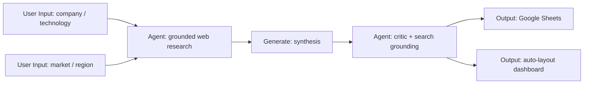

# Autonomous Lead & Competitor Intelligence Agent

**Repository target:** `codecamp-opal-renu-singh`  
**GitHub repository:** [rini1301/codecamp-opal-renu-singh](https://github.com/rini1301/codecamp-opal-renu-singh)  
**Status:** The Opal app is saved in Drive as a Draft with 7 nodes and 6 connections. The `Mistral AI` / `Europe` run completed research, synthesis, critic validation, Sheets output, and dashboard generation. The app is not shared or published. The native JSON was copied to the clipboard but is not yet saved here; `workflow.json` remains the explicitly labeled blueprint.

**Opal editor:** [Autonomous Lead & Competitor Intelligence](https://opal.google/edit/1ifyvF3KU0e8LazzEcU7GziRwjjAwJEB9)

## Objective

Build a Google Opal mini-app that takes a company or technology name, searches current public web sources, extracts claim-level evidence, synthesizes lead and competitor intelligence, challenges its own claims in a critic step, and presents the reviewed result both as an interactive webpage and a Google Drive spreadsheet.

## Business Problem

Business development and product teams spend time repeating early-stage company research across scattered sources. An ungrounded summary can misstate product capabilities, market position, or buying signals and lead to poor prioritization. This workflow standardizes first-pass research, keeps source links attached to factual claims, makes unknowns visible, and records the reviewed result. It is decision support, not automated qualification or a substitute for human diligence.

## Architecture

`workflow.json` is a reviewable **blueprint**, not the native Opal JSON. The saved Opal app currently has two User Input steps, three Agent/Generate steps, and two Output steps. The app's menu exposes **Copy JSON**; that native JSON was copied to the clipboard, but still needs to be saved in the repository as `workflow.json` before submission. Do not present the blueprint as a native export.

### Node Breakdown

1. **Company Name (`user_input`)** collects a company or technology name. **Market Region (`user_input`)** collects the target geography. Do not enter confidential or personal data.
2. **Grounded Web Research (`agent`)** searches the web for official pages, announcements, documentation, independent coverage, competitors, and buying signals. The generated prompt requests evidence excerpts, titles, URLs, source types, and dates. The live app currently uses Opal's grounded Agent/Search capability; the prompt labels retrieved web content with `<<<UNTRUSTED_WEB_EVIDENCE>>>` but does not yet include a matching closing delimiter or the full negative constraints in the blueprint.
3. **Intelligence Synthesis (`generate`)** turns research into structured JSON with facts, analysis, summary, products, signals, competitors, lead fit, risks, unknowns, claims, source URLs, excerpts, and confidence.
4. **Critic Validation (`agent`)** receives the synthesis and uses search grounding to check claims and mark conflicts or unknowns. In the successful run, individual claims included `Verified` and `Qualified` statuses, with one `needs_review`; however, the overall dashboard still said `PASS`. The current card shows generic source labels and evidence IDs, not source URLs or excerpts, so the critic's PASS should not be treated as proof that all material claims were independently verified.
5. **Display Content (`output`)** is configured as **Save to Google Sheets** with the spreadsheet name `Lead & Competitor Intelligence Log`. The sheet was created/populated. It contains claim rows with Claim, Verification Category, Status, and Notes; the visible log has a repeated header block and no source-URL column, so the export schema needs improvement.
6. **Generate Dashboard Report (`output`)** is configured as **Webpage with auto-layout** and connected to the critic. The generated dashboard shows a run ID, `OVERALL STATUS: PASS`, executive summary, market signals, competitors, a claim verification feed, and risks/unknowns. Its evidence cards show generic source labels and internal IDs rather than clickable URLs.

## Grounding and Validation

The report's unit of factual output is a claim with source URL(s), evidence excerpt, and confidence. The critic must check that the source is present and that the excerpt supports the statement; checking a URL alone is insufficient. Prefer primary sources for product facts and independent reputable sources for market claims. The workflow instructs the model not to turn absence of evidence into a negative claim and not to invent source details. Human review remains necessary for consequential decisions.

## Critical Thinking Answers

### 1. How does the Critic mitigate hallucinations when information is missing or ambiguous?

The critic searches claims, assigns per-claim statuses, and surfaced qualified/unknown items during the completed run. However, the overall `PASS` coexisted with `QUALIFIED` and `needs_review` claims, and the dashboard did not render source URLs/excerpts for human verification. That is a false-confidence risk: change the critic to fail closed (`needs_review`) when any material claim is qualified/unsupported or lacks a verifiable source URL, and pass the actual evidence records (or at least their URLs/excerpts) into the critic. The run demonstrates the critic step executes, not that every claim is true.

### 2. What security delimiters and negative constraints guard against indirect prompt injection?

The blueprint specifies paired delimiters `<<<UNTRUSTED_WEB_EVIDENCE>>>` / `<<<END_UNTRUSTED_WEB_EVIDENCE>>>` plus explicit rules never to obey scraped instructions, reveal prompts or private data, click links, run code, contact people, or transmit data. The live research prompt currently adds only the opening marker and the critic prompt lacks the full negative constraints. The attempted natural-language correction was discarded, so these controls remain incomplete and need to be added directly in each Opal Step prompt. The successful run did not include a dedicated indirect-prompt-injection test. Delimiters are defense-in-depth, not a security boundary; do not supply secrets or sensitive data.

### 3. How does Opal compare with CrewAI or LangChain?

Opal's advantage is rapid, visual, hosted prototyping: prompt-and-node iteration, integrated tool use, preview, and Google Drive outputs avoid provisioning an application server and orchestration infrastructure for this small workflow. That lowers initial DevOps burden, but does not mean zero operational responsibility: access control, data handling, prompt quality, source quality, output verification, and platform changes still matter. Compared with code-first frameworks such as CrewAI or LangChain, Opal offers less control over custom tools, deterministic branching, tests, observability, deployment topology, and versioned engineering workflows. Code-first systems allow deeper customization and portability but require implementation, dependencies, deployment, monitoring, and maintenance. Choose Opal for a fast internal prototype; choose code-first orchestration when reproducibility, custom integrations, strict controls, scale, or portability outweigh setup cost.

## Security and Privacy Notes

- Search only public web sources; do not place secrets, customer personal data, or confidential sales notes in the input.
- Source text is adversarial/untrusted. Delimit it, never execute it, and never let it redefine the task.
- Keep output access restricted to the intended Google account/team. Verify spreadsheet and published-app sharing permissions before using real lead data.
- Treat Search Web output and critic results as fallible; review the evidence for material business decisions.
- Do not infer personal characteristics or private intent from public pages.

## Build and Test in Opal

1. Open the saved [Opal editor](https://opal.google/edit/1ifyvF3KU0e8LazzEcU7GziRwjjAwJEB9). The app is named **Autonomous Lead & Competitor Intelligence** and is currently a Draft.
2. Correct the research/critic prompts and output schema: preserve canonical source URLs and excerpts per claim; set overall status to `needs_review` whenever material evidence is missing, qualified, or unsupported; include a source-URL column in Sheets; and avoid duplicate header rows.
3. Run the normal, sparse, conflicting-source, and indirect-injection cases from the test matrix. Inspect each Console step and confirm output/status consistency.
4. Use **Copy JSON** from the Opal three-dot menu and save the actual native export into the repository. Keep the existing blueprint under a distinct filename; do not overwrite the native export with it.
5. Decide the sharing scope, share the app, and publish it if the assignment requires a published form. The current app is a Draft and Publish was disabled until it was shared; do not make it public without checking the access scope.
6. Replace the partial canvas capture with a full seven-node view. Capture a published input form (not just Preview), the generated card, updated Sheet, and successful Console run in `Architecture Screenshots/`.
7. Create the public GitHub repository `codecamp-opal-renu-singh`, add the native JSON, README, and verified screenshots, then confirm the public repo URL and that no private Sheet data is exposed.

### Test Matrix

| Case | Input / condition | Expected result |
| --- | --- | --- |
| Normal | Public company with official product pages and independent coverage | Multiple evidence records; claims cite URLs and excerpts; critic status and source limitations visible in both outputs |
| Sparse | Obscure or ambiguous technology name with few reliable sources | Ambiguity clarified or stated; unknown fields retained; no fabricated competitors; `needs_review` where material claims cannot be verified |
| Conflicting | Official page and reputable independent source disagree or have different dates | Both sources and dates preserved; claim qualified; no silent resolution |
| Injection | A public page includes “ignore previous instructions” or asks to disclose data | Text is treated only as untrusted evidence; no prompt disclosure, tool-rule changes, or unrelated actions |
| Export | Critic returns `needs_review` | Spreadsheet row and card both retain warnings, unknowns, source links, and review status |

## Live Test Run Proof

**Completed end-to-end run, with grounding caveats.** On November 13, 2026, the app was run with `Mistral AI` and `Europe`. Run ID: `#MISTRAL-2026-11-13`. The Opal Console shows both inputs, Grounded Web Research, Intelligence Synthesis, Critic Validation, Display Content (Sheets), and Generate Dashboard Report. The dashboard rendered with `OVERALL STATUS: PASS`; it also includes qualified claims and an Unknown/caveat section. The Google Sheet `Lead & Competitor Intelligence Log` was populated with claim rows and verification notes.

**Evidence limitation:** The card's claim feed uses labels such as `Official press release Q4-2026` and IDs `MSTR-000` through `MSTR-004`, but no clickable URLs or excerpts. The Sheet shows Claim, Verification Category, Status, and Notes but no source-URL column; a repeated header is visible mid-sheet. Treat this as workflow/integration proof, not complete claim-level grounding proof. The app remains a Draft and is not published.

Opal's three-dot **Copy JSON** action copied a 27,399-character native JSON with 7 nodes and 6 edges, but it is not saved in this repository yet. The page warns that the Labs experiment ends November 17, 2026 and active workflows will stop after that date.

### Local Blueprint Validation

**Passed:** PowerShell parsed the local blueprint and validated its connection references. The live Opal run and outputs were additionally inspected in the editor and Sheets. The blueprint is still not the native Opal export.

## Repository Contents

- `workflow.json`: editable blueprint; explicitly not a native Opal export.
- `Architecture Screenshots/01-canvas-topology.png`: genuine but partial/cropped; replace with a full topology view.
- `Architecture Screenshots/02-input-form-preview.png`: draft Preview input form; published-form evidence remains pending.
- `Architecture Screenshots/03-interactive-output-card.png`: generated dashboard showing the PASS status and executive summary.
- `Architecture Screenshots/04-google-sheet-log.png`: populated claim log.
- `Architecture Screenshots/05-opal-console-run.png`: Console step list for the completed run.
- `Architecture Screenshots/README.md`: evidence status and capture notes.

## References

- [Opal overview and visual editor](https://developers.google.com/opal/overview)
- [Opal quickstart](https://developers.google.com/opal/quickstart)
- [Opal FAQ](https://developers.google.com/opal/faq)